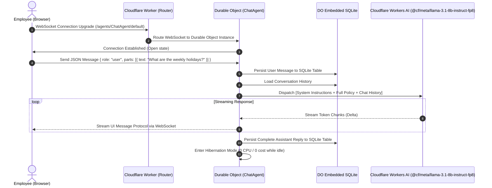

# XYZ Company HR Leave Assistant

> **A production-ready, stateful enterprise AI assistant built with the Cloudflare Agents SDK, Cloudflare Workers AI, and Durable Objects with embedded SQLite.**

---

## 📑 Table of Contents

- [Overview](#-overview)
- [Problem Statement](#-problem-statement)
- [The Solution](#-the-solution)
- [Architecture & Data Flow](#-architecture--data-flow)
- [Why Cloudflare Agents? (Comprehensive Comparison)](#-why-cloudflare-agents-comprehensive-comparison)
- [Cloudflare Free Tier Limits & Quotas](#-cloudflare-free-tier-limits--quotas)
- [System Guardrails & Verification](#-system-guardrails--verification)
- [UI & Design System](#-ui--design-system)
- [Project Directory Layout](#-project-directory-layout)
- [Local Development & Deployment Guide](#-local-development--deployment-guide)

---

## 🌟 Overview

The **XYZ Company HR Leave Assistant** is a self-contained, stateful AI chat solution engineered to provide immediate, compliant, and legally grounded answers regarding XYZ Company's Leave Policy (**HR-POL-004 Version 2.0**).

Unlike conventional stateless chatbots that rely on external vector databases, fragile embeddings, and third-party LLM providers (like OpenAI or Anthropic), this application runs **100% on the Cloudflare global network**. It leverages:

- **Cloudflare Agents SDK (`agents`, `@cloudflare/ai-chat`)**: Real-time stateful agents with bidirectional WebSocket streaming.
- **Durable Objects with Embedded SQLite**: True per-user conversational persistence with zero external database configuration.
- **Cloudflare Workers AI**: Ultra-low-latency on-edge model inference powered by `@cf/meta/llama-3.1-8b-instruct-fp8`.
- **Single-Page Application (SPA)**: React 19, Tailwind CSS v4, and Phosphor Icons hosted natively via Cloudflare Workers Static Assets.

---

## 🛑 Problem Statement

Enterprise HR departments spend thousands of hours every year fielding repetitive leave inquiries from employees: _“Can I combine casual leave with annual leave?”_, _“What is the sick leave submission deadline?”_, _“How many days carry forward?”_.

Deploying traditional AI chatbots to solve this problem regularly creates severe operational and legal risks:

1. **Hallucination & Policy Drifting**: Standard LLMs without strict grounding fabricate leave policies, confuse probation periods, or invent carry-forward exceptions that expose organizations to employee disputes and compliance liabilities.
2. **Stateless Fragility**: Serverless functions (AWS Lambda, Vercel) are stateless by default. Maintaining conversational context requires round-tripping to external databases (PostgreSQL, Redis, or DynamoDB) on every message, introducing network overhead, connection pooling issues, and synchronization race conditions.
3. **RAG Complexity & Chunking Failures**: For policy manuals of concise size (under 10,000 words), traditional Retrieval-Augmented Generation (RAG) vector pipelines are an anti-pattern. Chunking splits interconnected clauses (e.g., probationary rules split across Annual Leave and Casual Leave sections), causing semantic search to return partial, out-of-context snippets that mislead the LLM.
4. **Data Privacy & Confidentiality Breaches**: Inquisitive users frequently attempt to extract colleagues' leave status or medical history (_“Is Rahim out on sick leave today?”_). Naive chatbots easily succumb to prompt injection or casually disclose private personnel records.
5. **Cost & Vendor Lock-In**: Relying on external proprietary LLM APIs introduces API key leakage vectors, variable per-token pricing, third-party rate limits, and latency spikes across external networks.

---

## 💡 The Solution

The **XYZ Company HR Leave Assistant** eliminates these liabilities through architectural guarantees:

```
┌────────────────────────────────────────────────────────────────────────┐
│                        DETERMINISTIC HR AGENT                          │
│                                                                        │
│   [Full Policy Context]  +  [Strict Guardrails]  +  [Workers AI FP8]   │
│            │                       │                       │           │
│   Zero vector chunking     Exact section citation    Zero external API │
│   Holistic cross-reference Zero-tolerance fallback   keys or egress fee│
│   No semantic miss         Confidentiality shield    Private edge infer│
└────────────────────────────────────────────────────────────────────────┘
```

1. **Deterministic Context Stuffing**: The complete text of **HR-POL-004** is compiled directly into the backend agent runtime (`LEAVE_POLICY_TEXT`). Every conversation pass has full, holistic visibility over all 11 sections simultaneously—zero vector database, zero chunking loss, and zero retrieval latency.
2. **Native Stateful Persistence with Durable Objects SQLite**: Each conversation instance binds to a Durable Object that writes directly to its co-located SQLite engine. Chat history survives browser reloads, connection drops, and client hibernation without any external database.
3. **Self-Contained Edge Inference**: Model inference runs entirely on Cloudflare Workers AI GPUs using `@cf/meta/llama-3.1-8b-instruct-fp8`. No tokens leave the Cloudflare network, guaranteeing high throughput and compliance.
4. **Hardcoded Backend Guardrails**: The Agent backend strictly enforces three invariant rules:
   - **Rule 1 (Mandatory Citation)**: Every factual statement must cite its exact policy section in brackets (e.g., `[Section 4.1]`).
   - **Rule 2 (Zero-Tolerance Fallback)**: Any query outside the leave policy strictly yields: `"I don't know, please contact HR."`
   - **Rule 3 (Privacy Shield)**: Any attempt to query employee-specific records or leave reasons strictly yields: `"Leave records are confidential. I cannot share information about other employees. Please contact the HR Department."`

---

## 📐 Architecture & Data Flow

### 1. End-to-End Query Lifecycle



### 2. Edge Topology

```mermaid
flowchart TD
    subgraph Client ["Client Layer (Browser)"]
        UI["React 19 SPA (Dark UI)"]
        WS["useAgentChat WebSocket Hook"]
    end

    subgraph Cloudflare ["Cloudflare Global Network (Anycast Edge)"]
        Assets["Workers Static Assets (Vite Client Bundle)"]
        Router["Cloudflare Worker Entry (src/server.ts)"]

        subgraph AgentEnv ["Stateful Execution Environment"]
            DO["Durable Object: ChatAgent"]
            SQL[("Embedded SQLite DB\n(Persistent State)")]
            Prompt["HR_SYSTEM_PROMPT\n(Full Policy HR-POL-004 v2.0)"]
        end

        subgraph Compute ["Cloudflare Workers AI Cluster"]
            GPU["Workers AI (NVIDIA GPUs)"]
            Model["@cf/meta/llama-3.1-8b-instruct-fp8"]
        end
    end

    UI <-->|HTTP / Static Assets| Assets
    WS <-->|Bidirectional WebSockets| Router
    Router <-->|Direct RPC Binding| DO
    DO <-->|Microsecond Read/Write| SQL
    DO -->|Injects Context| Prompt
    Prompt -->|Inference Request| GPU
    GPU -->|Accelerated FP8 Model| Model
    Model -->>|Streamed Response| DO
```

---

## 📊 Why Cloudflare Agents? (Comprehensive Comparison)

The table below contrasts the **Cloudflare Agents SDK** architecture against industry-standard **Traditional RAG + Stateless Serverless** approaches:

| Feature / Dimension            | Cloudflare Agents SDK (This Architecture)                                                                                                                                        | Traditional RAG + Stateless Serverless (e.g. AWS Lambda + Pinecone + OpenAI)                                                                                 |
| :----------------------------- | :------------------------------------------------------------------------------------------------------------------------------------------------------------------------------- | :----------------------------------------------------------------------------------------------------------------------------------------------------------- |
| **State Persistence**          | **Native SQLite inside Durable Object**: Conversation history is persisted automatically in local SQLite storage with sub-millisecond query time.                                | **External Database Dependency**: Must query external DB (PostgreSQL, DynamoDB, Redis) on every turn, adding network latency and connection pool management. |
| **State Reconnect & Recovery** | **Seamless WebSocket Resumption**: Durable Object maintains connection state; clients seamlessly resume conversations after network drops.                                       | **Manual Session Reconstruction**: Client must re-fetch state via REST APIs and manually rehydrate context on page reloads.                                  |
| **Idle Cost & Hibernation**    | **Automatic Hibernation**: Durable Objects automatically hibernate to memory/disk when idle. You pay **$0.00** when no messages are actively being processed.                    | **Provisioned Concurrency Costs**: Keeping containers warm or paying for provisioned database capacity incurs ongoing idle costs.                            |
| **Cold Starts**                | **Zero Cold Starts**: Cloudflare V8 isolates spin up in **under 5 milliseconds** globally across 300+ data centers.                                                              | **Heavy Container Spin-up**: Python or Node containers often incur 500ms to 3,000ms cold-start penalties.                                                    |
| **Grounding Strategy**         | **Full Context Stuffing**: The complete, authoritative policy is injected into every inference turn. 100% of the document is evaluated with zero semantic loss.                  | **Vector Chunking & Embedding**: Chunks slice policy text arbitrarily; semantic search frequently misses cross-section constraints or subtle caveats.        |
| **LLM Provider & Keys**        | **100% Self-Contained Workers AI**: Runs locally on Cloudflare hardware. No third-party API keys, no risk of external secret leakage, no vendor bill shock.                      | **Third-Party API Dependency**: Requires external API keys (OpenAI, Anthropic) with outbound HTTP latency, strict rate limits, and external outages.         |
| **Data Locality & Privacy**    | **Edge-Confined Data**: Neither messages nor policy text ever leave Cloudflare's secure infrastructure. Compliance is dramatically simplified.                                   | **Multi-Hop Egress**: Data hops across client, hosting provider, vector database provider, and LLM provider, multiplying attack surface area.                |
| **Unified Hosting & Compute**  | **Single Repository, Single Deploy**: Static assets (React SPA), backend router (Worker), and stateful agent (DO) deploy together in a single atomic command (`npm run deploy`). | **Fragmented Tooling**: Separate deployments for S3/CloudFront, Lambda/Serverless Framework, Vector DB schemas, and API Gateways.                            |

---

## 💰 Cloudflare Free Tier Limits & Quotas

Cloudflare offers one of the most generous developer free tiers in the industry. This project is configured to run smoothly within these limits:

| Resource / Product             | Free Tier Quota                     | Application Consumption & Strategy                                                                                                   | Free Tier Exhaustion Impact                                              |
| :----------------------------- | :---------------------------------- | :----------------------------------------------------------------------------------------------------------------------------------- | :----------------------------------------------------------------------- |
| **Cloudflare Workers**         | **100,000 requests / day**          | Each page load and WebSocket connection uses 1 request.                                                                              | Throttles to HTTP 429 until daily reset (UTC midnight).                  |
| **Workers CPU Time**           | **10 ms CPU time / request**        | Durable Object routing and parsing takes < 2ms CPU time.                                                                             | Standard free quota is more than sufficient for light parsing.           |
| **Cloudflare Workers AI**      | **10,000 Neurons / day**            | `@cf/meta/llama-3.1-8b-instruct-fp8` consumes approx. 20-30 Neurons per chat turn. This yields **~300 to 500 free queries per day**. | Returns error if daily neuron cap is reached until next daily UTC cycle. |
| **Durable Objects Storage**    | **1 GB SQLite storage**             | Chat logs use ~1 KB per message. 1 GB stores over **1,000,000 chat messages** without additional cost.                               | Writes fail once storage limit is exceeded.                              |
| **Durable Objects Operations** | **1 Million Read/Write units / mo** | Cached SQLite operations minimize billable DO I/O.                                                                                   | Free tier covers extensive evaluation and small-to-medium team testing.  |
| **Static Assets (CDN)**        | **Unlimited requests & bandwidth**  | React client bundle (HTML, CSS, JS chunks) is cached at edge locations worldwide with zero egress costs.                             | **No limit** on static asset delivery.                                   |
| **Idle Time Billing**          | **$0.00 (Zero idle cost)**          | Durable Objects automatically enter hibernation state when no WebSockets are active.                                                 | **No cost incurred** when no users are chatting.                         |

---

## 🛡️ System Guardrails & Verification

The assistant’s backend strictly hardcodes three foundational rules within `src/server.ts` that cannot be overridden by user prompt injections:

### Rule 1: Strict Accuracy & Mandatory Section Citations

- **Constraint**: Answers must be derived exclusively from **HR-POL-004**. Guesses, outside assumptions, or invented exceptions are strictly prohibited. Basic arithmetic (e.g., addition, multiplication) using the exact numbers in the policy is permitted to answer specific employee scenarios (e.g., 6 months × 1.67 days = 10.02 days).
- **Mandatory Output**: Every factual response must append the exact policy section in brackets.
- **Example**:
  > _"You have earned 10.02 days of Annual Leave. [Section 4.1]"_
  > _"The weekly holidays at XYZ Company are Friday and Saturday. [Section 5.1]"_

### Rule 2: Out of Scope (Zero-Tolerance Fallback)

- **Constraint**: If an inquiry touches matters outside the leave policy (e.g., compensation, remote work arrangements, device allocation, general knowledge), the assistant must decline immediately without pleasantries or excuses.
- **Mandatory Output**:
  > `"I don't know, please contact HR."`

### Rule 3: Data Privacy & Confidentiality Protection

- **Constraint**: Personal leave records, medical justifications, or individual employee balances are strictly protected under Section 9. Queries regarding a specific coworker or manager are immediately blocked.
- **Mandatory Output**:
  > `"Leave records are confidential. I cannot share information about other employees. Please contact the HR Department."`

---

## 🎨 UI & Design System

The frontend provides an executive-grade **Dark Mode** interface tailored for corporate environments:

- **Palette**: Deep slate backgrounds (`bg-slate-950`, `bg-slate-900`) with high-contrast text (`text-slate-100`, `text-slate-200`) and emerald/teal accents (`text-teal-400`, `bg-teal-600`).
- **Iconography**: Custom **Atom** icon (`AtomIcon` from `@phosphor-icons/react`) representing precision and intelligence.
- **Top Navigation Bar**:
  - Assistant title and identity.
  - Subtitle: _"Official Leave Policy Advisor"_.
  - **"Delete History"** action button to reset SQLite conversation state with a single click.
- **Assistant Message Bubbles**:
  - Clean `XYZ HR Assistant` header (no repeated badge clutter).
  - Streaming markdown rendering with syntax-highlighted code blocks via `streamdown`.
  - Responsive typing indicators during token generation.
- **Sticky Input Bar**:
  - Multi-line autosizing textarea with `Enter` (send) and `Shift + Enter` (newline) support.
  - Streaming interrupt button (`StopIcon`) to halt active responses.
  - Subtle footer status with no unnecessary branding.

---

## 📁 Project Directory Layout

```
c:\hr-assistant\
├── public/
│   ├── favicon.ico             # Browser favicon
│   └── xyz.png                 # Brand asset backup
├── src/
│   ├── app.tsx                 # Dark UI React 19 chat interface with useAgentChat
│   ├── client.tsx              # Browser DOM hydration entry point
│   ├── policy.ts               # Constant LEAVE_POLICY_TEXT (source of truth)
│   ├── server.ts               # Cloudflare ChatAgent class, DO router, Workers AI call
│   └── styles.css              # Tailwind CSS v4 styling & dark typography
├── scripts/
│   └── verify.mjs              # Test script verifying policy constraints & guardrails
├── instructions.txt            # System instructions and prompt rules
├── policy.txt                  # Full text of XYZ Company Leave Policy (HR-POL-004 v2.0)
├── vite.config.ts              # Vite configuration with Cloudflare Workers plugin
├── wrangler.jsonc              # Cloudflare Worker configuration (DO, AI, Static Assets)
├── wrangler.toml               # Backward-compatible Wrangler configuration
├── package.json                # Project dependencies and operational scripts
└── tsconfig.json               # TypeScript strict configuration
```

---

## 🚀 Local Development & Deployment Guide

### 1. Prerequisites

- **Node.js**: v20+ or v24+ LTS installed.
- **Cloudflare Account**: A free Cloudflare account with Workers AI enabled.

### 2. Installation

```bash
npm install
```

### 3. Local Development

Start the development server with live Vite reloading:

```bash
npm run dev
```

Open [http://localhost:5173](http://localhost:5173) in your browser.

> **Note on Workers AI**: Cloudflare Workers AI model inference executes on Cloudflare GPUs. When testing locally, ensure you are authenticated by running:
>
> ```bash
> npx wrangler login
> ```

### 4. Code Quality & Formatting

Ensure all TypeScript types and code styles pass:

```bash
npm run check
```

_(Runs `oxfmt` format check, `oxlint` static code analysis, and `tsc --noEmit`)._

### 5. Production Build & Verification

Test the production bundle with a dry-run deploy:

```bash
npm run deploy -- --dry-run
```

### 6. Live Deployment

Deploy both the frontend static assets and backend agent to Cloudflare Workers with one command:

```bash
npm run deploy
```

Once deployed, Wrangler will output your live URL:

```
Published hr-assistant (x.xx sec)
  https://hr-assistant.<your-subdomain>.workers.dev
```

---

## 📄 License & Attribution

This project is created for the **XYZ Company HR Assessment**.  
Built using the [Cloudflare Agents SDK](https://developers.cloudflare.com/agents/) and [Cloudflare Workers AI](https://developers.cloudflare.com/workers-ai/).
